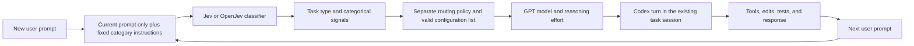

# Adaptive Coding Agents

Adaptive Model and Reasoning Selection for AI Coding Agents is a research project to choose a GPT coding model and reasoning effort for each user prompt in a Codex-based terminal workflow. Jev or OpenJev receives only the current prompt as task content and classifies a task type plus a few signals; a separate routing policy maps those categories to a supported model/effort configuration. Codex retains its coding-session context. Executable coding benchmarks measure whether the complete system improves the trade-off between correctness, cost, and completion time.

The first study asks: **Does fine-tuning OpenJev improve routing over untuned OpenJev, producing better task performance or lower cost/token usage?** Correctness comes first. Among similarly reliable configurations, the project prefers lower cost and time. Report dollars and tokens separately; classifier overhead and training costs are part of the evaluation.

## Status

As of October 24, 2026, this repository contains planning documents only. The premature prototype, its archived copy, and generated protocol files were deleted at the owner's request. Phase 0 is complete. The owner selected conservative defaults for the first offline build and plans to start development tomorrow; that contract is ready, while broader Phase 1 research/live-integration gates remain open. No live coding-model, benchmark, or training result has been established.

[Development plan](docs/development-plan.md) is the primary roadmap. The Milestone 2 schedule is inactive; development now follows design and evidence gates rather than that deadline. Python is the selected design direction for the initial terminal/router, training, benchmarking, and analysis, with one Codex execution path. The owner has no language requirement; the earlier TypeScript/Python split was an agent recommendation. The owner reports $3,333 in API credits and will choose a cap after reviewing a run-by-run estimate. Cloud spending must remain strictly under $50 cumulatively. No paid experiment was started by this planning work.

The context includes the original research proposal supplied by the owner and the later Milestone 1 scope decisions. Broader research hypotheses and optional experiments are preserved in [Research hypotheses and extensions](docs/research-notes.md).

## Start here

Read [AGENTS.md](AGENTS.md) and [HANDOFF.md](HANDOFF.md) when starting a new agent session. The remaining documents cover the decisions that should survive across sessions:

| Document | Purpose |
| --- | --- |
| [Project brief](docs/project-brief.md) | Problem, intended value, agreed scope, resources, and risks |
| [Architecture](docs/architecture.md) | Per-prompt routing, Codex integration, and component boundaries |
| [Evaluation](docs/evaluation.md) | SWE-bench output, comparison strategies, training data, and run records |
| [Training plan](docs/training-plan.md) | OpenJev identity, supervised adapter proposal, compatibility checks, and training economics |
| [Research review](docs/research-review.md) | Primary-source findings, stack/model recommendations, and related-work overlap |
| [Technical discovery](docs/technical-discovery.md) | Inspected local interfaces, attempted checks, and unproved live behavior |
| [Research notes](docs/research-notes.md) | Original routing hypotheses, optional comparisons, and related-work leads |
| [Development plan](docs/development-plan.md) | Ordered work, completion criteria, and unresolved decisions |
| [Phase 0 decisions](docs/phase-0-decisions.md) | Completed scope decisions, selected design, and later validation gates |
| [Phase 1 specification](docs/phase-1-specification.md) | Confirmed classification/policy flow, provisional categories, and remaining contracts |
| [First-build defaults](docs/first-build-defaults.md) | Selected offline records, limits, fallback, runtime setup, session behavior, and accounting |
| [Context sources](docs/context-sources.md) | Provenance, source limitations, and excluded private material |

To continue after cloning:

```sh
git clone https://github.com/AadiBiyani/Adaptive_Coding_Agents.git
cd Adaptive_Coding_Agents
```

When resuming development, ask the agent: **Read AGENTS.md and HANDOFF.md, then implement the first offline slice in docs/first-build-defaults.md. Keep real model calls, benchmark execution, and cloud training behind their remaining gates.**

There is no application installation or execution command yet. The next development session starts with an isolated Python 3.12 environment and the specified offline core, using simulated adapters and no model spending. Exact compatible SDK/runtime pins must be verified before adding the real adapter; later live checks require a reviewed estimate and cap.

## Intended workflow



Classification happens before each new user turn using only that prompt. Automatic reliable fallback handles insufficient information within remaining limits; its configuration will be selected from development evidence. Conversation history, repository context, and tool results remain with Codex. Additional classifier context and internal-step routing are possible later experiments. The initial task scope is repository bug fixing and debugging.

## Intended deliverables

The project will produce a usable terminal router, a cloud-fine-tuned OpenJev classifier, and a comparison report with SWE-bench patch-evaluation results. A smaller reproducible multi-turn evaluation will measure corrective follow-ups, and a stakeholder trial will provide qualitative workflow feedback.

The comparison includes a strong fixed GPT configuration, simple routing rules, a cheap learned classifier, hosted TypeSafe Jev, untuned OpenJev, and fine-tuned OpenJev under shared agent and evaluation conditions. Classifier variants supply categories to the same routing policy; the coding agent produces patches. Hold that policy fixed for the primary tuned/untuned comparison. Hosted Jev and independent OpenJev are separate models. Standard SWE-bench tests initial selection; a separate multi-turn protocol tests adaptation across user prompts. Our run records measure cost and tokens alongside executable patch results.

An ML paper is an intended output. Related work already covers several forms of model and effort routing, so novelty and performance gains must be established rather than assumed. Negative or inconclusive results should be reported honestly.

## Repository boundaries

Private stakeholder recordings, agreements, email screenshots, contact details, student identifiers, and the course submission archive stay outside this public repository. The project brief here is a development summary, not the exact stakeholder-approved evidence document. Runtime credentials, model weights, datasets, and raw agent traces are also excluded by default. Small reviewed aggregate results can be committed later with their reproduction instructions.
