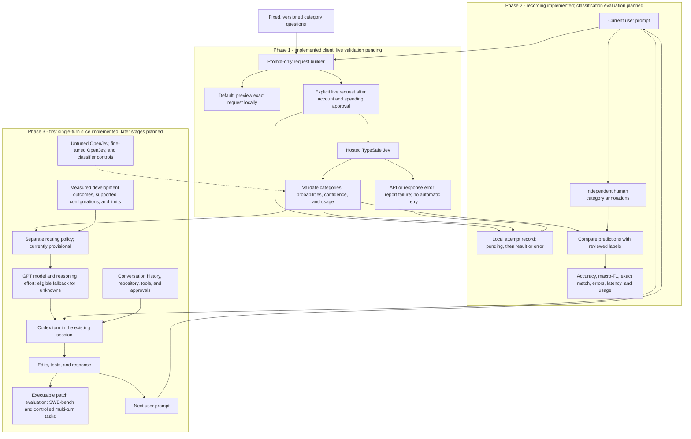

# Adaptive Coding Agents

**Adaptive Model and Reasoning Selection for AI Coding Agents** is a research project starting with Python debugging and bug fixing. The intended product classifies each new user prompt with Jev/OpenJev, then uses a separate policy to select a GPT model and reasoning effort. Codex keeps its existing conversation, repository access, tools, and approvals.

The primary research question is whether fine-tuning OpenJev improves routing compared with untuned OpenJev, leading to better task performance or lower cost/token usage. Correctness comes first; savings remain hypotheses until measured.

## Current checkpoint: stakeholder prototype, Part 1

The owner authorized five review checkpoints: (1) one prompt through Jev, routing, and Codex; (2) session continuity, fallback, and budgets; (3) a policy informed by development measurements; (4) a small SWE-bench comparison; and (5) a repeatable stakeholder demo. **This change implements Part 1 only and stops for manual review.** It does not mark the earlier classifier-accuracy phase complete.

`adaptive-code` now previews classifier requests, lets you inspect the policy using explicit labels, and has a live single-prompt execution path through the existing Jev client and the official Codex Python SDK. The pinned SDK and bundled runtime are both `0.163.0`; this does not replace the global Codex installation. The adapter uses the lower-level client with explicit approval handling, following the [SDK](https://learn.chatgpt.com/docs/codex-sdk) and [app-server](https://learn.chatgpt.com/docs/app-server) interfaces.

**No live Jev or Codex inference was performed for this change.** Local tests exercise the actual SDK against an offline protocol test server and intercept Jev HTTP. They establish software behavior, not live access, classification quality, coding success, or savings. The previous simulation implementation remains archived.

### Review Part 1 without spending

From this repository:

```sh
uv sync --locked --offline --no-python-downloads --cache-dir .cache/uv
.venv/bin/adaptive-code preview --prompt-file examples/python_bug_prompt.txt
.venv/bin/adaptive-code route --task-type fix --cause-evidence supporting_details --change-scope localized
.venv/bin/python -m unittest discover -s tests -v
```

On a fresh machine, install Python/uv and run `uv sync --locked` once to download the pinned dependencies. The preview returns `status: "preview"`, the unchanged prompt plus fixed Jev questions, four candidate model/effort pairs, and `selected_configuration: null`. It makes no calls and writes no files. The `route` command uses labels **you supplied**, not Jev predictions; this example selects `gpt-6-luna` with `low` effort. Its `policy_evidence` is `unvalidated_engineering_mapping`. Change `--change-scope` to `cross_component` to inspect the provisional `gpt-6.1-sol` / `high` route.

Check the missing-key path safely, even if your terminal already has a key:

```sh
env -u TYPESAFE_API_KEY .venv/bin/adaptive-code run --prompt-file examples/python_bug_prompt.txt --live
```

Expected: exit code 1, `missing_credentials`, a private `record_path`, and `coding_request_attempted: false`. Neither Jev nor Codex starts. The parent terminal's key is unchanged.

### What the live Part 1 path does

After a separately reviewed integration estimate and authorization, the command shape is:

```sh
.venv/bin/adaptive-code run --prompt-file /path/to/prompt.txt --cwd /path/to/your/scratch-repository --timeout-seconds 180 --live
```

This command can spend credits and edit the selected workspace. The earlier authorization for one standalone Jev request does not cover this coding run. No live account/model inspection was repeated during development.

The adapter checks Codex's paginated model catalog, calls Jev once with only the prompt, selects a route, and creates a Codex thread with explicit model/effort, workspace sandbox, and interactive approvals. It checks the returned thread settings before submitting the unchanged prompt as a coding turn, streams output, and records completion and available usage. There is no automatic retry. A denied approval is sent back as a denial; noninteractive input never approves an action. The classifier API key is blanked in the Codex child environment.

The four documented candidates are Luna/Sol at low/high effort. Runtime catalog support and returned settings are checked separately from documentation. The current mapping is an integration example, **not measured evidence that a configuration is appropriate**. Unknown categories, classifier failures, and unavailable routes stop this slice; Part 2 adds automatic fallback and budget rules. Part 1 starts one new thread and one user turn per invocation; follow-ups and resume belong to Part 2.

Private records live under ignored `runs/coding/<run-id>/workflow.json`, with the Jev attempt linked beneath the same run. They distinguish requested settings, accepted thread settings, turn-start acknowledgment, and unavailable execution telemetry. Cumulative usage events replace earlier totals rather than being summed. Billed coding cost, internal call/retry counts, and executable task success remain null when unobserved. A completed Codex turn is not proof that the bug is fixed. Pending/interrupted records must not be automatically replayed.

The timer closes the owned Codex process; Jev retains its own socket timeout. This is not dollar-budget enforcement or a guarantee that provider work immediately stops. The later budget and evaluation checkpoints remain necessary. Review Part 1 before authorizing Part 2; the [development plan](docs/development-plan.md) retains the full research deliverables.

## Overall architecture

GitHub renders this Mermaid diagram directly. The classifier client, attempt recorder, and first single-turn routing/Codex slice exist. Classification accuracy, live integration, subsequent-turn routing, learned policies, and benchmark evaluation remain unverified or planned.



Only the current prompt and fixed category definitions enter Jev. Code and tracebacks pasted into that prompt are allowed; the client does not fetch files or add history. Category annotations evaluate the classifier. Executable coding outcomes separately establish and evaluate the routing policy. Confidence is not the probability that a coding task will succeed.

## Test this checkpoint yourself

From the repository directory, using the existing Python 3.12.15 and uv 0.11.16 installation:

```sh
uv sync --offline --no-python-downloads --cache-dir .cache/uv
.venv/bin/python scripts/classify_prompt.py --prompt-file examples/python_bug_prompt.txt
```

The setup command uses locally installed/cached tools; a fresh machine needs Python and uv first. The pinned Codex SDK is now a runtime dependency; these standalone Jev checks still make no Codex calls.

Expected: JSON with `status: "preview"`, `request_attempted: false`, model `jev-1.14.0`, your complete prompt in `request.state`, and three Choice questions with `criteria` definitions. **Preview does not produce predicted categories or token usage.** It intentionally prints the request text for local review and saves no files.

[The example prompt](examples/python_bug_prompt.txt) includes Python code, reproduction, a traceback, and expected behavior. It is an illustrative input, not a benchmark result or a labeled accuracy dataset. You can use your own UTF-8 prompt file or pipe text in:

```sh
printf '%s\n' 'try again' | .venv/bin/python scripts/classify_prompt.py
.venv/bin/python scripts/classify_prompt.py --help
.venv/bin/python -m unittest discover -s tests -v
```

Local unit tests intercept HTTP responses and prevent network connections. They check unchanged multiline/Unicode prompts, byte limits, request format, malformed responses, missing usage, authentication errors, rate limits, timeouts, and no automatic retries. Passing these checks says nothing about Jev's classification accuracy. `/tests/` is intentionally ignored at the owner's request; the tests remain in this workspace and are not included in a fresh Git clone. The preview commands work with the public source and example alone.

## Review the Phase 2 recording checkpoint

The first Phase 2 slice adds one JSON record per attempted live classification under `runs/jev/<run-id>/attempt.json`. `--example-id` assigns an optional local reference; it is never sent to Jev. `--run-dir` changes the output directory relative to your current working directory. The default `runs/` directory is ignored by Git.

Run a safe recording check without contacting TypeSafe:

```sh
env -u TYPESAFE_API_KEY .venv/bin/python scripts/classify_prompt.py --prompt-file examples/python_bug_prompt.txt --example-id no-key-check --live
```

Expected: exit code 1, `status: "error"`, `error.code: "missing_credentials"`, `request_attempted: false`, and a `record_path` pointing to the saved JSON file. This deliberately removes the key only from that child process; your terminal's exported key is unchanged. Open the printed path to inspect the record. No API request is sent, and unavailable usage/cost remains null. This is a local credential-validation failure, not a model result.

Run the recording checks alone, or all checks:

```sh
.venv/bin/python -m unittest discover -s tests -p 'test_run_records.py' -v
.venv/bin/python -m unittest discover -s tests -v
```

Each record includes UTC timestamps, a unique run ID, optional example ID, requested/returned model, package version, taxonomy version, prompt/request hashes, and a snapshot and hash of the fixed questions. Completed records include the validated answers or a sanitized error, latency, available usage, and a dated cost estimate. Prompt text, API keys, and raw provider error bodies are omitted. Keep the original input separately if you need to reproduce the request; the hash does not reconstruct it.

The recorder writes `status: "pending"` before dispatch. If the initial write fails, the call is blocked. Completed records replace the pending record atomically. Ctrl-C during the call records `interrupted` when possible; a hard process exit can leave `pending`. Both mean the outcome or billing may be unknown, and neither triggers replay. A final-write failure returns `recording_error` and the in-memory `observed_result` for recovery; inspect those before any manual retry. Each new invocation creates a separate record, even when the example ID is reused.

Cost estimates use provider-reported input tokens and the dated published rate for the returned `jev-1.14.0` model: $0.042 per million input tokens, output tokens free, checked October 27, 2026. Missing input usage or an unpriced returned model leaves the estimate unavailable. `usage.billed_cost_usd` remains null; an estimate is not a verified bill. [TypeSafe pricing](https://docs.typesafe.ai/models)

The standalone recording slice has been reviewed and one standalone Jev request was authorized. Its authorization does not cover batches or coding runs. Dataset annotation, accuracy evaluation, and training remain pending; the newer Part 1 terminal slice is described above.

## Files to review

| File | What it does |
| --- | --- |
| [taxonomy.py](src/adaptive_coding_agents/taxonomy.py) | Defines the three fixed questions and every category description; provisional taxonomy `draft-1`. |
| [records.py](src/adaptive_coding_agents/records.py) | Validates prompts/categories, hashes exact prompt bytes, and defines classification/usage records. |
| [jev.py](src/adaptive_coding_agents/jev.py) | Builds the direct TypeSafe request, sends one HTTP call, validates the response, and reports sanitized failures. |
| [run_records.py](src/adaptive_coding_agents/run_records.py) | Saves pending/completed attempts atomically, records failures and uncertainty, and estimates cost from reported usage. |
| [classify_prompt.py](scripts/classify_prompt.py) | Reads a file or stdin; previews by default, records explicit live attempts, and accepts `--example-id` / `--run-dir`. |
| [cli.py](src/adaptive_coding_agents/cli.py) | Terminal previews, manual-label policy inspection, one-prompt execution, streamed output, and explicit approvals. |
| [routing.py](src/adaptive_coding_agents/routing.py) | Four candidate configurations and a clearly unvalidated engineering mapping. |
| [codex_session.py](src/adaptive_coding_agents/codex_session.py) | Pinned SDK integration, catalog pagination, setting validation, one coding turn, and usage events. |
| [workflow.py](src/adaptive_coding_agents/workflow.py) | Shared prompt-to-classifier-to-Codex orchestration boundary. |
| [workflow_records.py](src/adaptive_coding_agents/workflow_records.py) | Private workflow records written before dispatch and updated atomically. |

The taxonomy retains the earlier category names and adds explicit definitions:

| Field | Options |
| --- | --- |
| `task_type` | `diagnose`, `fix`, `validate`, `mixed_or_unclear` |
| `cause_evidence` | `supporting_details`, `hypothesis_only`, `unknown` |
| `change_scope` | `localized`, `cross_component`, `unknown` |

`draft-1` is provisional and needs review on development examples before accuracy evaluation. A request to repair a bug remains `fix` when explanation and tests support that repair. A traceback alone does not establish a localized change scope. Unknown categories remain valid answers; the Part 1 policy stops on them until the Part 2 fallback checkpoint.

## Direct TypeSafe integration

The client targets `https://api.typesafe.ai/v1/systemone` with the explicit model `jev-1.14.0`, using `TYPESAFE_API_KEY` from the environment. The HTTP format and model were checked against the [TypeSafe API](https://docs.typesafe.ai/api/system-one), [Choice reference](https://docs.typesafe.ai/primitives/choice), and [model list](https://docs.typesafe.ai/models) on October 25, 2026. It uses standard-library HTTP with a 30-second socket timeout, no automatic retries, and no redirects. A timeout may occur after the provider processed a request; missing usage stays unavailable.

Inputs over 16,384 UTF-8 bytes are rejected before transmission, without truncation. This is our initial application limit, not TypeSafe's maximum context size. Live results include requested and returned model IDs, category probabilities and confidence, prompt/request hashes, elapsed time, and available token counts. Actual billed cost remains null because this response does not establish the bill. Live output omits raw prompts and API keys; provider error bodies are not echoed.

**Phase 2 only:** after account setup, a reviewed estimate, and an approved cap, set `TYPESAFE_API_KEY` privately and explicitly add `--live`:

```sh
.venv/bin/python scripts/classify_prompt.py --prompt-file examples/python_bug_prompt.txt --example-id first-live-check --live
```

That command can incur charges; it is not a budget enforcement system or permission for automated batches. It saves a separate attempt record and prints its path alongside the validated response or error. No account or credits are needed for previews, local tests, or the explicit missing-key check above. OpenAI API credits do not fund TypeSafe Jev. [OpenAI credit terms](https://openai.com/policies/service-credit-terms/)

## Research and repository boundaries

The eventual comparison includes hosted TypeSafe Jev, untuned OpenJev, fine-tuned OpenJev, strong fixed configurations, simple rules, and a cheap learned classifier. Hosted Jev and OpenJev are separate models. Hold the taxonomy and downstream policy fixed in the primary tuned/untuned comparison. SWE-bench executable evaluation, a controlled multi-turn study, and stakeholder feedback remain deliverables.

Read the [project brief](docs/project-brief.md), [architecture](docs/architecture.md), [evaluation design](docs/evaluation.md), and [training plan](docs/training-plan.md) for those future stages. [HANDOFF.md](HANDOFF.md) records the current implementation and pause point.

Tests, the deferred local archive, generated runs, raw datasets, secrets, private conversations, stakeholder evidence, and course submissions stay out of Git. Small reviewed research reports and manifests may be committed later with real evidence. Nothing in this checkpoint is a measured model-performance result.
