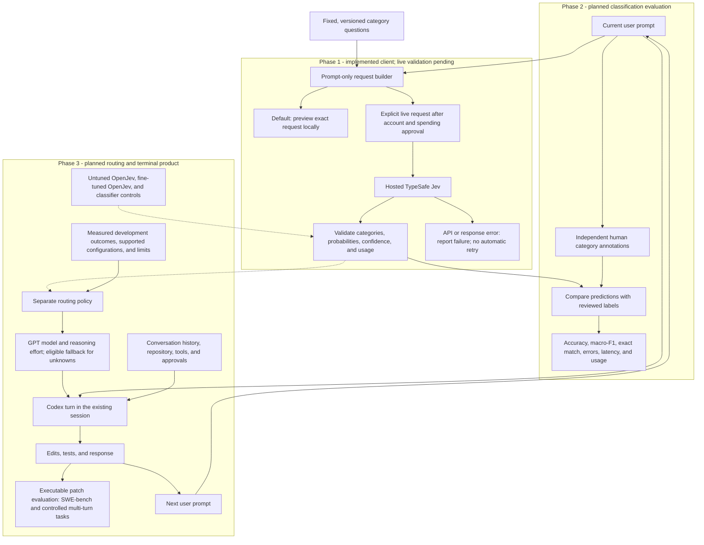

# Adaptive Coding Agents

**Adaptive Model and Reasoning Selection for AI Coding Agents** is a research project starting with Python debugging and bug fixing. The intended product classifies each new user prompt with Jev/OpenJev, then uses a separate policy to select a GPT model and reasoning effort. Codex keeps its existing conversation, repository access, tools, and approvals.

The primary research question is whether fine-tuning OpenJev improves routing compared with untuned OpenJev, leading to better task performance or lower cost/token usage. Correctness comes first; savings remain hypotheses until measured.

## Current checkpoint: Jev client

The active implementation is a direct **hosted TypeSafe Jev client** and a standalone request-review script. It builds three category questions, validates responses, and exposes provider token usage when available. Preview is the default and performs no network request. Explicit `--live` mode can send one request after account setup and spending approval.

**Live Jev inference has not been verified. There are no classifier accuracy, routing, or benchmark results yet.** The earlier simulated CLI/routing/Codex implementation is preserved in an ignored local archive and removed from the active package. No product terminal command or coding execution is active.

Development stops after every phase for owner testing and code review. The [development plan](docs/development-plan.md) defines the checkpoints.

## Overall architecture

GitHub renders this Mermaid diagram directly. The Phase 1 client exists; its live endpoint connection still awaits validation. Phases 2 and 3 are planned.



Only the current prompt and fixed category definitions enter Jev. Code and tracebacks pasted into that prompt are allowed; the client does not fetch files or add history. Category annotations evaluate the classifier. Executable coding outcomes separately establish and evaluate the routing policy. Confidence is not the probability that a coding task will succeed.

## Test this checkpoint yourself

From the repository directory, using the existing Python 3.12.15 and uv 0.11.16 installation:

```sh
uv sync --offline --no-python-downloads --cache-dir .cache/uv
.venv/bin/python scripts/classify_prompt.py --prompt-file examples/python_bug_prompt.txt
```

The setup command uses locally installed/cached tools; a fresh machine needs Python and uv first. Runtime dependencies are empty. Sync also removes the old `adaptive-code` entrypoint from this environment.

Expected: JSON with `status: "preview"`, `request_attempted: false`, model `jev-1.14.0`, your complete prompt in `request.state`, and three Choice questions with `criteria` definitions. **Preview does not produce predicted categories or token usage.** It intentionally prints the request text for local review and saves no files.

[The example prompt](examples/python_bug_prompt.txt) includes Python code, reproduction, a traceback, and expected behavior. It is an illustrative input, not a benchmark result or a labeled accuracy dataset. You can use your own UTF-8 prompt file or pipe text in:

```sh
printf '%s\n' 'try again' | .venv/bin/python scripts/classify_prompt.py
.venv/bin/python scripts/classify_prompt.py --help
.venv/bin/python -m unittest discover -s tests -v
```

Local unit tests intercept HTTP responses and prevent network connections. They check unchanged multiline/Unicode prompts, byte limits, request format, malformed responses, missing usage, authentication errors, rate limits, timeouts, and no automatic retries. Passing these checks says nothing about Jev's classification accuracy. `/tests/` is intentionally ignored at the owner's request; the tests remain in this workspace and are not included in a fresh Git clone. The preview commands work with the public source and example alone.

## Files to review

| File | What it does |
| --- | --- |
| [taxonomy.py](src/adaptive_coding_agents/taxonomy.py) | Defines the three fixed questions and every category description; provisional taxonomy `draft-1`. |
| [records.py](src/adaptive_coding_agents/records.py) | Validates prompts/categories, hashes exact prompt bytes, and defines classification/usage records. |
| [jev.py](src/adaptive_coding_agents/jev.py) | Builds the direct TypeSafe request, sends one HTTP call, validates the response, and reports sanitized failures. |
| [classify_prompt.py](scripts/classify_prompt.py) | Reads a file or stdin; previews by default and requires `--live` to contact TypeSafe. |

The taxonomy retains the earlier category names and adds explicit definitions:

| Field | Options |
| --- | --- |
| `task_type` | `diagnose`, `fix`, `validate`, `mixed_or_unclear` |
| `cause_evidence` | `supporting_details`, `hypothesis_only`, `unknown` |
| `change_scope` | `localized`, `cross_component`, `unknown` |

`draft-1` is provisional and needs review on development examples before accuracy evaluation. A request to repair a bug remains `fix` when explanation and tests support that repair. A traceback alone does not establish a localized change scope. Unknown categories remain valid answers; this checkpoint does not map them to a coding configuration.

## Direct TypeSafe integration

The client targets `https://api.typesafe.ai/v1/systemone` with the explicit model `jev-1.14.0`, using `TYPESAFE_API_KEY` from the environment. The HTTP format and model were checked against the [TypeSafe API](https://docs.typesafe.ai/api/system-one), [Choice reference](https://docs.typesafe.ai/primitives/choice), and [model list](https://docs.typesafe.ai/models) on October 25, 2026. It uses standard-library HTTP with a 30-second socket timeout, no automatic retries, and no redirects. A timeout may occur after the provider processed a request; missing usage stays unavailable.

Inputs over 16,384 UTF-8 bytes are rejected before transmission, without truncation. This is our initial application limit, not TypeSafe's maximum context size. Live results include requested and returned model IDs, category probabilities and confidence, prompt/request hashes, elapsed time, and available token counts. Actual billed cost remains null because this response does not establish the bill. Live output omits raw prompts and API keys; provider error bodies are not echoed.

**Phase 2 only:** after account setup, a reviewed estimate, and an approved cap, set `TYPESAFE_API_KEY` privately and explicitly add `--live`:

```sh
.venv/bin/python scripts/classify_prompt.py --prompt-file examples/python_bug_prompt.txt --live
```

That flag can incur charges; it is not a budget enforcement system or permission for automated batches. No account or credits are needed for Phase 1 previews/tests. OpenAI API credits do not fund TypeSafe Jev. [OpenAI credit terms](https://openai.com/policies/service-credit-terms/)

## Research and repository boundaries

The eventual comparison includes hosted TypeSafe Jev, untuned OpenJev, fine-tuned OpenJev, strong fixed configurations, simple rules, and a cheap learned classifier. Hosted Jev and OpenJev are separate models. Hold the taxonomy and downstream policy fixed in the primary tuned/untuned comparison. SWE-bench executable evaluation, a controlled multi-turn study, and stakeholder feedback remain deliverables.

Read the [project brief](docs/project-brief.md), [architecture](docs/architecture.md), [evaluation design](docs/evaluation.md), and [training plan](docs/training-plan.md) for those future stages. [HANDOFF.md](HANDOFF.md) records the current implementation and pause point.

Tests, the deferred local archive, generated runs, raw datasets, secrets, private conversations, stakeholder evidence, and course submissions stay out of Git. Small reviewed research reports and manifests may be committed later with real evidence. Nothing in this checkpoint is a measured model-performance result.
