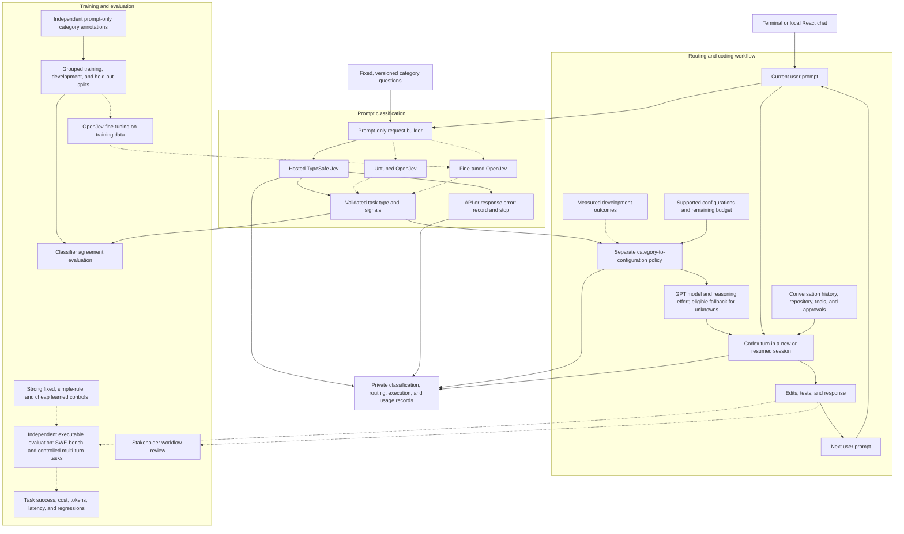

# Adaptive Coding Agents

**Adaptive Model and Reasoning Selection for AI Coding Agents** is a research project and coding product for choosing a model and reasoning effort for each new user prompt. It starts with Python bug fixing and debugging, with the aim of improving task completion while reducing unnecessary cost, time, and corrective prompts.

The workflow is: **user prompt → Jev classification → routing policy → GPT model and reasoning effort → Codex execution**. A terminal command and a localhost chat app share the same Python execution path, preserving Codex's conversation, repository access, tools, and approvals. The browser frontend uses JavaScript, React, and shadcn/ui. The OpenRouter analogy describes a common entry point for model selection.

The primary research question is: **Does fine-tuning OpenJev improve routing compared with untuned OpenJev, producing better executable task outcomes or lower cost/token usage?** Correctness comes first, followed by cost and time among similarly reliable choices. Those improvements are hypotheses to measure.

## Overall architecture

This diagram describes the full project, including the planned training and benchmark components. GitHub renders it directly. Implementation and validation status are summarized below.



Jev/OpenJev receives **only the current user prompt and fixed category definitions**. Code or tracebacks pasted into that prompt are allowed. History, repository content fetched by the agent, tool results, and prior failures stay outside the classifier input. Codex retains its own session context. Routing occurs before each new user prompt, not between internal tool calls.

## Classification and routing

The classifier predicts a task type plus a few signals. A separate policy maps those labels to an explicitly supported model/effort pair. This keeps semantic classification separate from performance measurements and pricing.

The current provisional taxonomy is `draft-1`:

| Field | Categories |
| --- | --- |
| `task_type` | `diagnose`, `fix`, `validate`, `mixed_or_unclear` |
| `cause_evidence` | `supporting_details`, `hypothesis_only`, `unknown` |
| `change_scope` | `localized`, `cross_component`, `unknown` |

Definitions will be refined on training/development examples and frozen before held-out evaluation. Category confidence is not the probability that the coding task will succeed.

The current registry contains `gpt-6-luna` and `gpt-6.1-sol`, each with `low` and `high` effort. The adapter checks the runtime catalog and returned settings. The mapping is an **unvalidated engineering policy**; measured development outcomes must establish which configurations are useful. Unknown or mixed labels use an explicit provisional fallback when supported and affordable. Malformed responses and provider errors stop without automatic retries.

## Research and expected outputs

The project has three main outputs: a usable terminal router, a cloud-fine-tuned OpenJev classifier, and a reproducible evaluation report.

The primary comparison holds the OpenJev base checkpoint, taxonomy, downstream policy, coding harness, and evaluation conditions fixed while comparing untuned and fine-tuned weights. Hosted TypeSafe Jev is a separate comparison model; it is not assumed equivalent to OpenJev. Strong fixed configurations, simple rules, and a cheap learned classifier provide competitive controls.

**SWE-bench remains a central deliverable.** Generated patches will be graded with a pinned, isolated executable evaluator on Python repository tasks. Strategies will be rerun under matched conditions; published leaderboard results provide context. A separate controlled multi-turn study will test rerouting across user messages, recovery, and regressions. A standard single-prompt SWE-bench run cannot establish those multi-turn benefits.

Results will report task success alongside total cost, tokens, latency, failures, retries, and classifier overhead. Training, hosting, and benchmark compute will be tracked separately. Independent category annotations train and evaluate the classifier; executable coding outcomes establish the routing policy and determine task correctness. Held-out outcomes must not influence either training or policy selection. Stakeholder review will assess the terminal's usefulness in a real development workflow.

## Implementation status

| Area | Current state |
| --- | --- |
| Hosted classification | Direct TypeSafe System One client pinned to `jev-1.14.0`, response validation, private attempt records, and one recorded real response. |
| Terminal and Codex integration | Python CLI with explicit routing, streaming, approvals, resume support, and pinned official SDK/runtime `0.163.0`. One owner-run routed repair passed three independently rerun, unchanged tests. Live session continuity and fallback remain to be verified. |
| Credentials and spending | Ignored local credentials, persistent reservations and attempt limits, uncertain-usage handling, and provisional fallback. |
| Local chat app | JavaScript/React, Vite, Tailwind, and shadcn/ui: arbitrary prompts, streamed responses, saved chats, approvals, workspace files, and offline token-price comparisons. Uses the same Python workflow as the terminal. |
| Tests & analysis | Local project, frontend, and workspace checks with progress, per-test results, logs, cancellation, run history, source fingerprints, and report export. These are software checks, not SWE-bench scores. |
| Classifier evaluation | Reviewed-label checks, grouped split validation, and metrics runner. Authored pilot prompts await human annotation; no accuracy result is established. |
| Measured routing policy | Planned; the current mapping and fallback have no measured reliability advantage. |
| OpenJev adaptation | Untuned comparison and cloud fine-tuning remain planned. |
| Coding benchmarks | SWE-bench, controlled multi-turn evaluation, and strategy comparisons remain planned. |

Offline tests verify software behavior. They do not establish classification quality, coding success, live continuity, or savings. Current work and review instructions belong in [HANDOFF.md](HANDOFF.md); the [development plan](docs/development-plan.md) tracks the implementation sequence.

## Getting started

Use Python 3.12 and uv. Install the pinned dependencies:

```sh
uv sync --locked
```

Preview a request or inspect the mapping without credentials, provider calls, or spending:

```sh
.venv/bin/adaptive-code preview --prompt 'Fix only last_item: [] raises IndexError; return None for an empty list.'
.venv/bin/adaptive-code route --task-type fix --cause-evidence supporting_details --change-scope localized
.venv/bin/adaptive-code --help
```

Preview shows the exact prompt and fixed questions; it does not predict labels. The `route` command uses labels you supplied to inspect the provisional mapping.

For live use, store credentials privately in an ignored `.env` in the invocation directory:

```dotenv
TYPESAFE_API_KEY=
OPENAI_API_KEY=
```

Environment values take precedence. The loader reads only the specified file, without parent-directory searches, shell execution, or variable expansion. `--env-file` selects another file; `--no-env` uses only exported credentials. Check presence without printing values:

```sh
.venv/bin/adaptive-code credentials
.venv/bin/adaptive-code budget status
```

Live terminal operations require `--live` and an initialized budget. In the browser, pressing **Send** starts the live workflow against that same budget. **The owner performs all actions that consume tokens or money; development agents use offline checks and supply commands for manual execution.** See [the handoff](HANDOFF.md#manual-review) for the reviewed budget, runnable examples, expected behavior, and the current pause point.

The command supports one prompt per invocation and `--session` for subsequent prompts in the same coding conversation. The classifier receives each prompt independently while Codex resumes its history.

### Local chat app

With the Python dependencies, local `.env`, and existing budget set up, build the JavaScript frontend using Node.js 22.12+ and npm:

```sh
npm ci --prefix frontend
npm run build --prefix frontend
.venv/bin/adaptive-code ui
```

Open **http://127.0.0.1:8765**. Starting the server, opening chats, and viewing spending make no model calls. Sending a message invokes Jev and the routed coding agent. The existing budget and attempt limits apply; the UI does not reset them.

Type any coding prompt. Enter sends; Shift+Enter inserts a newline. Responses render Markdown and copyable code blocks. **Why this route** shows Jev's labels and the selected model/effort. Tool approvals appear in the conversation. **Stop** requests cancellation; final charges can remain uncertain and block further calls.

The default code folder is `runs/workspaces/default/`. Select an existing folder using the workspace button, or launch with `--cwd /absolute/path/to/project`. The **Files** button previews files there. Answers and code snippets appear in chat; files are created only when the agent writes them. Follow-ups in a conversation resume its Codex session while Jev sees only the new prompt.

The **Spending** tab reprices the routed run's reported tokens for a selectable fixed model/effort, defaulting to Sol/high from the current registry. It includes the classifier estimate on the routed side and never runs the baseline model. Rates and cache assumptions are visible. Reasoning tokens are already part of output; changing effort has no invented price multiplier. This is a same-token pricing scenario, not measured savings or an invoice. Resumed runs may expose cumulative thread snapshots, which are labeled and never added across runs.

For frontend development, keep the backend running and use `npm run dev --prefix frontend` in another terminal. Vite serves http://127.0.0.1:5173 with a local API proxy. Rebuild before using the single-server production frontend at port 8765.

### Tests & analysis

Open **Tests** in the header or **Tests & analysis** in the sidebar. Choose **Project checks** for the local Python regression suite, **Frontend checks** for React rendering checks, or **Workspace tests** for Python tests in the selected coding folder. Press **Run tests** to see progress, pass/fail details, output, and saved history. No model request is made and the API budget is unchanged.

Workspace tests use Python's `unittest` discovery with `test*.py`. Keep the test-folder field as `.` for files such as `test_cart.py` in the workspace root, or enter `tests` for a test subdirectory. Use trusted local code: this runner disables ordinary Python network/child-process calls and removes inherited API credentials, but it is not an untrusted-code sandbox. The current runner does not support pytest-only suites or repositories requiring a different environment.

Each run records its source fingerprint, Python/platform information, exact command, elapsed time, outcome, and available individual checks. Empty suites, errors, timeouts, skipped suites, and cancellation are explicit outcomes. **Export report** downloads the record for inspection. The saved local copy is under ignored `runs/evaluations/`. Output and detail previews have bounded sizes. Files changing during a run are flagged.

This is the interface foundation for SWE-bench analysis. The later benchmark adapter must supply pinned tasks, containerized execution, independently graded patches, and matched strategy comparisons. The current local results and Spending estimates do not establish routing quality or benchmark savings. The separately budgeted Jev classifier pilot remains available through the terminal after human annotation; this tab does not start classifier batches.

Where the local test suite is present:

```sh
.venv/bin/python -m unittest discover -s tests -v
```

Tests intercept provider HTTP, exercise the SDK against a local protocol test server, and check the UI backend with simulated workflows. The UI checks need the frontend build and permission to bind a temporary loopback port. `node tests/ui-render.mjs` checks React rendering without model calls. The owner keeps `tests/` ignored, so it is not included in a fresh clone.

## Records and accounting

Private audit records under ignored `runs/` link classifier attempts, routing decisions, coding turns, session IDs, and spending reservations. They distinguish requested settings, accepted settings, observed usage, estimates, and unavailable billing details. Raw prompts and keys are omitted from the audit records; native Codex history retains the conversation for resume. Browser conversations separately save prompt/response text and visible tool activity in ignored `runs/ui/chats/`, using private local files. Earlier CLI responses cannot be reconstructed from metadata alone; new browser conversations capture their own transcripts.

Spending limits are admission controls. Missing or uncertain usage blocks further calls instead of being treated as free, and late usage can exceed a reservation. Resumed-thread token totals can include earlier work, so current accounting conservatively reserves against full observed totals and does not claim exact per-turn experimental cost. A completed model response is not proof that a task is solved.

## Repository guide

| Location | Purpose |
| --- | --- |
| [backend/src/adaptive_coding_agents/](backend/src/adaptive_coding_agents/) | Python API, classifier client, routing, shared Codex workflow, records, spending, and local evaluation jobs. |
| [frontend/](frontend/) | JavaScript React app and generated shadcn/ui components; builds static assets served by the local Python backend. |
| [backend/scripts/](backend/scripts/) | Classifier pilot preparation and the retained original classifier script used by local regression checks. Use the budgeted CLI for live calls. |
| [pyproject.toml](pyproject.toml) and `uv.lock` | Root Python packaging and dependency configuration; the package source is `backend/src/`. Existing root commands and local settings keep their paths. |
| `tests/` and `runs/` (ignored) | Local verification checks; private coding, chat, budget, and evaluation records. |
| [docs/project-brief.md](docs/project-brief.md) | Product purpose and agreed scope. |
| [docs/architecture.md](docs/architecture.md) | Architecture contracts and integration design. |
| [docs/evaluation.md](docs/evaluation.md) | SWE-bench, multi-turn protocols, comparisons, and reporting requirements. |
| [docs/training-plan.md](docs/training-plan.md) | OpenJev adaptation, data separation, and training feasibility. |
| [docs/development-plan.md](docs/development-plan.md) | Development sequence and review checkpoints. |
| [HANDOFF.md](HANDOFF.md) | Current implementation state, evidence, review commands, and next steps. |

The initial scope is research and personal testing. Secrets, stakeholder evidence, personal contacts, course submissions, raw private conversations, datasets, generated runs, and model artifacts stay out of Git. The private course package is separate from product development.
