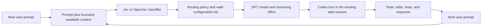

# Adaptive Coding Agents

Adaptive Model and Reasoning Selection for AI Coding Agents is a research project to choose a GPT coding model and reasoning effort for each user prompt in a Codex-based terminal workflow. A Jev or OpenJev classifier supplies routing signals; executable coding benchmarks measure whether those choices improve the trade-off between correctness, cost, and completion time.

The research question is: **Can a lightweight decision model allocate coding models and reasoning effort to reduce total cost while preserving task success?** Correctness comes first. Among similarly reliable configurations, the project prefers lower cost and time.

## Status

This repository starts with project context and a development plan. The Milestone 1 proposal and submission package were finalized separately on September 28, 2026. No router, trained classifier, benchmark runner, or experimental results have been implemented in this repository. A successful milestone packaging check does not establish product performance or confirm a course submission was uploaded.

The context includes the original research proposal supplied by the owner and the later Milestone 1 scope decisions. Broader research hypotheses and optional experiments are preserved in [Research hypotheses and extensions](docs/research-notes.md).

## Start here

Read [AGENTS.md](AGENTS.md) and [HANDOFF.md](HANDOFF.md) when starting a new agent session. The remaining documents cover the decisions that should survive across sessions:

| Document | Purpose |
| --- | --- |
| [Project brief](docs/project-brief.md) | Problem, intended value, agreed scope, resources, and risks |
| [Architecture](docs/architecture.md) | Per-prompt routing, Codex integration, and component boundaries |
| [Evaluation](docs/evaluation.md) | SWE-bench output, comparison strategies, training data, and run records |
| [Research notes](docs/research-notes.md) | Original routing hypotheses, optional comparisons, and related-work leads |
| [Development plan](docs/development-plan.md) | Ordered work, completion criteria, and unresolved decisions |
| [Context sources](docs/context-sources.md) | Provenance, source limitations, and excluded private material |

To continue after cloning:

```sh
git clone https://github.com/AadiBiyani/Adaptive_Coding_Agents.git
cd Adaptive_Coding_Agents
```

Then ask the agent: **Read AGENTS.md and HANDOFF.md, summarize the current state, and continue with the first unfinished step in docs/development-plan.md.**

There is no application installation or execution command yet. The first development task is to verify the Codex integration and define a small reproducible pilot before spending on model calls or cloud compute.

## Intended workflow



Classification happens before each new user turn. Automatic rerouting during internal tool calls is a possible later extension. The initial task scope is repository bug fixing and debugging.

## Intended deliverables

The project will produce a usable terminal router, a cloud-fine-tuned OpenJev classifier, and a comparison report with SWE-bench patch-evaluation results. A smaller reproducible multi-turn evaluation will measure corrective follow-ups, and a stakeholder trial will provide qualitative workflow feedback.

The comparison includes a strong fixed GPT configuration, simple routing rules, hosted TypeSafe Jev, untuned OpenJev, and fine-tuned OpenJev under shared agent and evaluation conditions. Hosted Jev supplies decisions; the coding agent produces patches. Hosted Jev and the independent OpenJev model are separate baselines.

## Repository boundaries

Private stakeholder recordings, agreements, email screenshots, contact details, student identifiers, and the course submission archive stay outside this public repository. The project brief here is a development summary, not the exact stakeholder-approved evidence document. Runtime credentials, model weights, datasets, and raw agent traces are also excluded by default. Small reviewed aggregate results can be committed later with their reproduction instructions.
